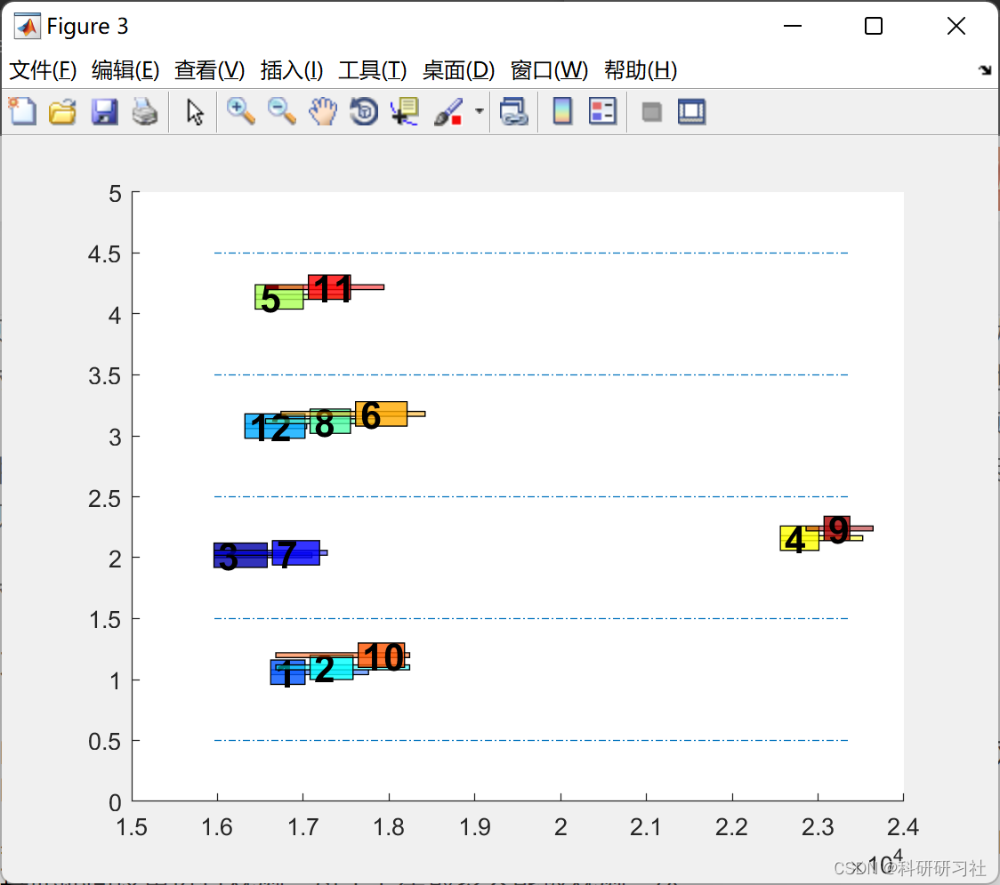
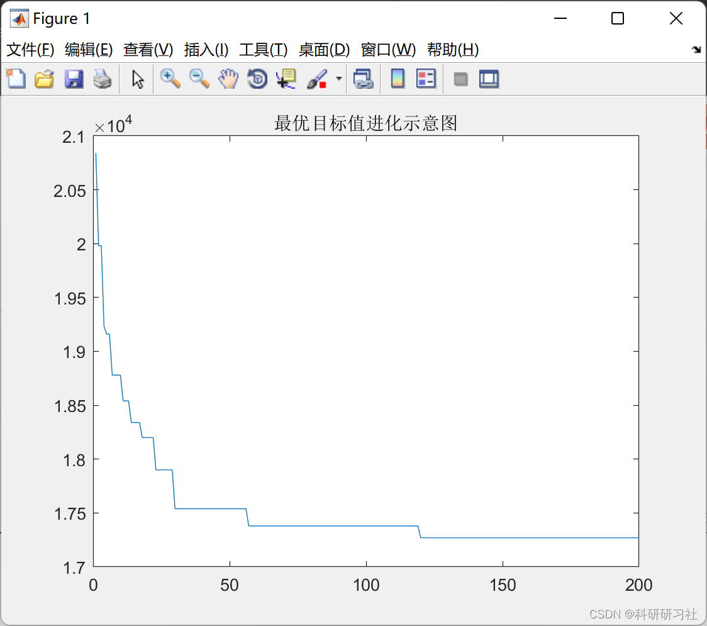
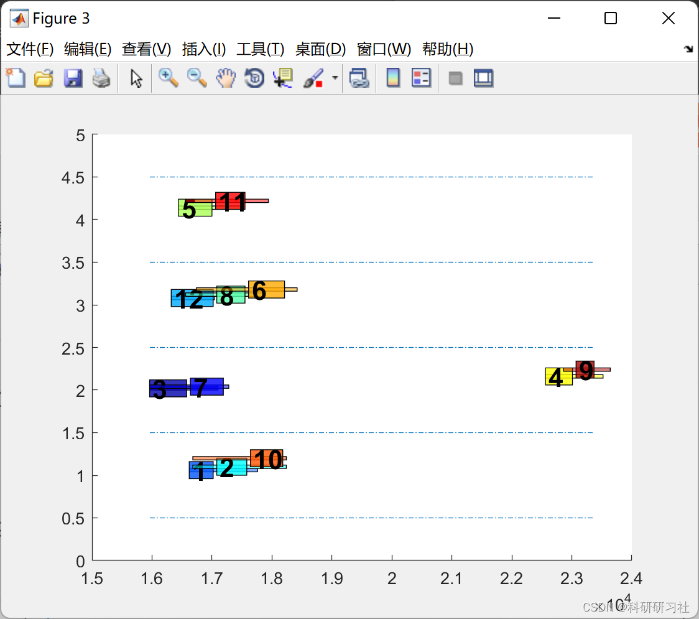

# Solving Multi-Satellite Task Planning with Time Window Constraints Based on Improved Genetic Algorithm (Matlab Code Implementation)

​  
1. Overview of Satellite Observation Task Scheduling Problem
The satellite observation task scheduling problem is described as follows. Based on the requirements for space-based satellite observations, it is necessary to schedule observation tasks for in-orbit satellites over China's territory, given the limited availability of ground observation equipment. Assuming that there are M ground observation devices (each equipped with a corresponding observation mission) and N satellites to be observed, where M << N. Each satellite has P available time windows for observation, which vary depending on the satellite and the observation device. Each observable device can observe any satellite within its corresponding time window, with the duration of the observation varying according to the actual observation time required by the satellite during the mission.At the same time, any satellite can be observed by ground observation equipment within its visible time window. Due to the physical characteristics of the observation equipment, each ground observation device needs to undergo a transition time before observing the next satellite after completing observations on one satellite. The transition time varies depending on the specific characteristics of the equipment. When selecting which segment of the visible time window to observe on which satellite, different satellites have varying priorities due to differing actual observation tasks. The more important the role of the satellite, the higher its priority. Additionally, the higher the precision of the ground observation equipment, the higher its priority.It is not difficult to understand. High priority ground observation equipment should be selected for observation with high-priority satellites as much as possible. Throughout the planning and scheduling of the entire observation mission, Each satellite should be observed at most once. The objective of scheduling is to achieve the following: As much as possible, observe more priority satellites in a shorter time. Maximize the priority of the final satellite and ground station.
Additionally, in the task scheduling of observing multiple satellites, the following constraints should be met:
1. Ground observation equipment cannot interrupt observations during a visible time window for one of the satellites due to equipment failure reasons, and the observation duration must meet the observation time requirements specified in the actual mission planning for that satellite;
2. The same ground observation equipment can only observe a specific satellite within a specific visible time window at the same time, and the same visible time window for a satellite can only be observed by a single ground device at a time;
3. Once one of the satellite's time windows is observed by one ground device, no other ground device can observe any visible time window for that satellite, and each satellite can be observed only once;
4. For the same ground observation equipment, it needs to undergo a transition time before starting the observation of the next satellite after completing the observation of one satellite;
5. In this paper, the satellite observation tasks are scheduled based on optical observation, without considering other physical factors such as frequency between observation devices and satellites. Assuming good weather conditions and that all equipment and satellites are visible within the satellite's visible time window. The mathematical model is described in Section 3.
2 Operational Results
Edit
Edit
Edit
%% Calculate the objective function\n    T = max(time_end_guance);\n    total_rank = 0;\n    for j = 1:Global.num_satellite\n        cur_satellite = satellite_list(j); %Current satellite\n        cur_ground = ground_list(j); %The ground station currently selected for the satellite\n        total_rank = total_rank + Global.rank_ground(cur_ground) * Global.rank_satellite(cur_satellite);\n    end\n    \n    %% Output value\n    population(i).objs = [T - 10*total_rank];\n    population(i).cons = cons;\n    population(i).time_start_guance = time_start_guance;\n    population(i).time_end_guance = time_end_guance;\n    population(i).ground_list = ground_list;\n    population(i).index_window_guance = index_window_guance;\n    population(i).ground_next_release_time = ground_next_release_time;\nend\n  
4. References
[1] Baozi Yang, Yu Jizhou, Yang Shan. Intelligent Optimization Algorithms and Their MATLAB Examples (2nd Edition) [M]. Electronic Industry Press, 2016.
[2] Zhang Yan, Wu Shuigen. MATLAB Optimization Algorithm Source Code [M]. Tsinghua University Press, 2017.

## Images

<!-- PAYMENT_BLOCK -->

## Get this dataset

- Payment link (Stripe): [Buy now](https://buy.stripe.com/3cs8yP7sY87d0vu9AB)
- Payment QR code: 

<!-- /PAYMENT_BLOCK -->
